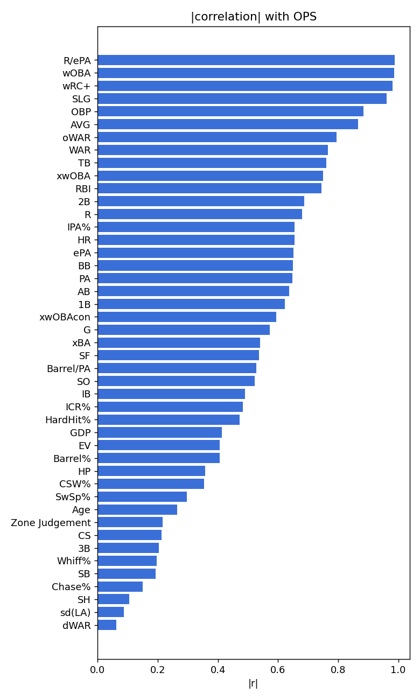
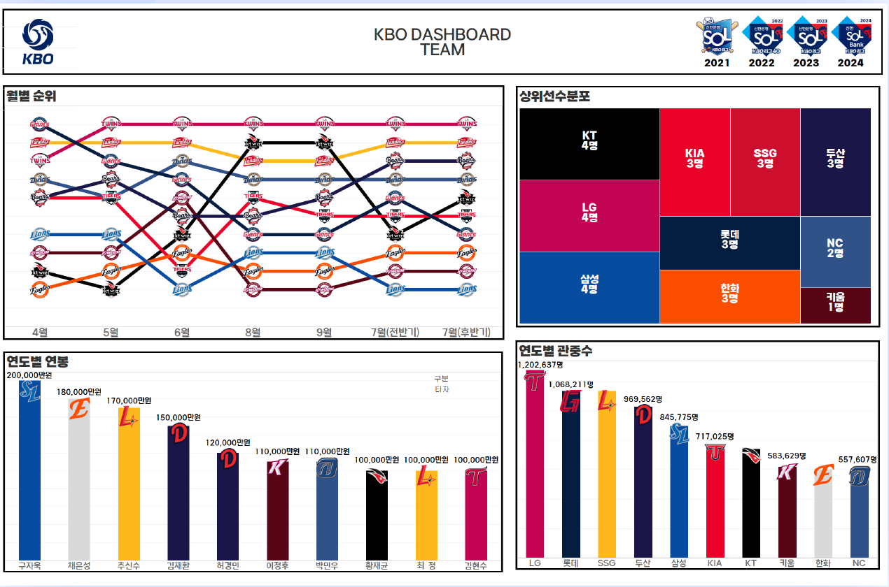
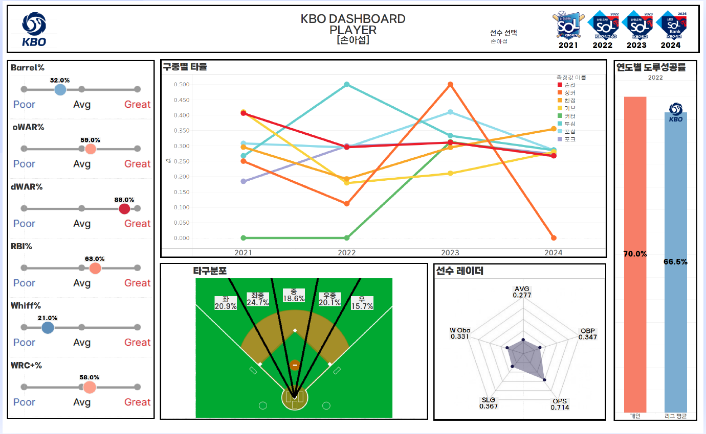
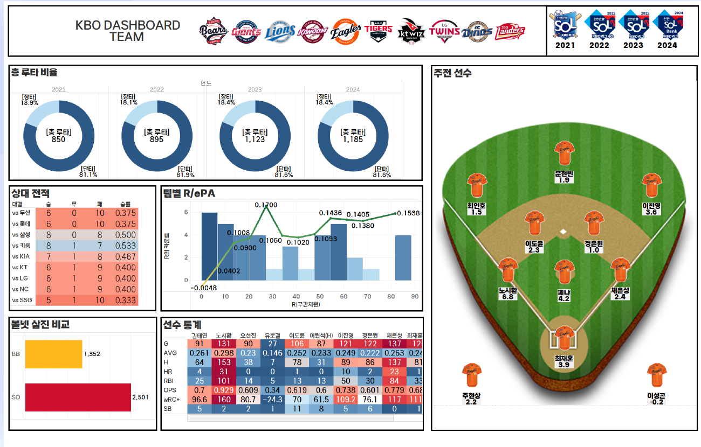

# KBO 타자 OPS 예측 프로젝트

KBO 타자 2021~2024 기록을 직접 크롤링해 데이터셋 구축, 같은 시즌 세부 타격 지표로 OPS를 예측(추정)하는 회귀 모델과 Tableau 팀·선수 대시보드 제작

| 항목 | 내용 |
|---|---|
| 기간 | 2025.01 ~ 2025.03 (겨울방학 스터디) |
| 팀 | 잠실은 내꺼야 — 권석민, 김도현, 장유진, 정혜민 (4명) |
| 주제 | 데이콘 「KBO 타자 OPS 예측 경진대회」(2019) 주제 활용, 데이터는 2021~2024 직접 수집 |
| 사용 기술 | Python, Selenium, BeautifulSoup, pandas, PyCaret, scikit-learn, Tableau |
| 역할 | 전 과정 공동 수행 (각자 크롤링·전처리·EDA·모델링·대시보드 진행 후 비교해 최종안 채택) |

<br>

---

## 진행 흐름

```
크롤링 (crawling/, 재실행 불가)
  Statiz ─┐
          ├─ 병합 ─> data/kbo_batting_2021_2024.csv ─> 전처리 ─> EDA ─> 모델링 ─> 2024 평가
  KBO Insight ─┘                                      (src/, CSV부터 실행)
```

- 출처 사이트 변경으로 재수집 불가 → 크롤링 코드는 `crawling/`에 분리, 분석은 최종 CSV부터 진행
- 크롤링·병합은 팀원별로 진행 후 합친 결과라 보관 코드의 출력과 최종 CSV의 변수 구성이 일부 다름
- 2021~2023 학습, 2024 OPS는 정답으로 떼어 두고 평가

<br>

---

## 1. 데이터 수집 (`crawling/`)

| 출처 | 방법 | 주요 변수 |
|---|---|---|
| Statiz | requests + BeautifulSoup | 타격 기록, WAR·oWAR·dWAR, AVG·OBP·SLG·OPS, wRC+ |
| KBO Insight | Selenium + BeautifulSoup (동적 페이지) | wOBA, EV, HardHit%, Barrel%, Whiff%, xBA, xwOBA 등 |
| Statiz 구종별 | Selenium + BeautifulSoup | 구종별 타격 기록 (Tableau용, 모델 미사용) |

개발자 도구로 표 구조(`tr`/`td`) 확인 후 연도별 수집. 결과: [`data/kbo_batting_2021_2024.csv`](data/README.md) (106명 × 4시즌, 424행 × 50열)

<br>

**데이터 연결 확인**
- Statiz 크롤링 출력 ↔ `data/raw/statiz_final.csv`: 476행, 29개 열 불일치 0건
- `statiz_final.csv` ↔ 최종 CSV의 Statiz 열: 동명이인 제외 402행 불일치 0건 (`tests/test_data.py`)
- KBO Insight 수집 원본은 미보유

<br>

---

## 2. 전처리

| 단계 | 내용 | 위치 |
|---|---|---|
| ① 크롤링 데이터 정리 | 4시즌 모두 기록 있는 선수만, 은퇴·해외 이적 제외, 동명이인은 이름 뒤 팀 표기 | 최종 CSV에 반영 |
| ② 30타석 미만 삭제 | 기록이 불안정한 시즌 제외 → 학습 307행 / 평가 95행 | `src/data.py` |
| ③ H(안타) 수정 | H − 2B − 3B − HR = 1루타(1B), 장타 변수와 중복 제거 | `src/data.py` |
| ④ 중복 변수 제거 | 다른 변수로 계산되거나 의미가 겹치는 변수 | 모델링 02~04만 (`src/data.py`) |
| ⑤ VIF 기반 제거 | VIF 10 초과 34/45개 → 높은 변수 제거, OPS 핵심 지표(OBP, SLG, wRC+)는 유지 | 모델링 02~04만 (`src/data.py`) |

<br>

- 결측값 1건(Chase%), ② 기준에서 제외
- 이상치 별도 처리 없음
- 모델링 01 입력: ①~③ 후 식별 정보, OPS 직접 계산 지표(OBP, SLG, TB, R/ePA 등) 제외 36개
- 모델링 02~04 입력: ④·⑤ 후 16개 (나이, oWAR, R, RBI, BB, SO, GDP, SF, OBP, SLG, wRC+, SwSp%, CSW%, xBA, xwOBA, 1B)

<br>

---

## 3. EDA (`src/01_eda.py`)

| OPS와의 상관계수 | 주요 변수 산점도 |
|---|---|
|  |  |

- R/ePA, wOBA, wRC+, SLG, OBP가 OPS와 강한 양의 상관 (|r| 0.88~0.99)
- OBP, SLG, xwOBA는 정규분포에 가까움, SF·GDP는 특정 값에 몰림 (`histograms.png`, `qq_plots.png`)
- ⑤ 이후 16개 변수에서도 VIF 높음 (wRC+ 61.4, OBP 26.5, SLG 18.2) → PCA 시도 (모델링 02~04)

<br>

---

## 4. 모델링

### 모델링 01 — PyCaret + 스태킹, 최종 (`src/02_pycaret_stacking.py`)

1. `compare_models`: 회귀 모델 전체 10-fold 교차검증 → RMSE 상위 5개 (선형회귀, Bayesian Ridge, Huber, Ridge, OMP)
2. `tune_model`: 5개 하이퍼파라미터 튜닝
3. `stack_models`: 스태킹 (메타모델 선형회귀)

<br>

### 모델링 02~04 — PCA + 스태킹 (`src/03_pca_stacking.py`)

누적 설명분산 90% 기준 주성분 3개(93.0%), 기반 모델 5개(선형회귀, LARS, Bayesian Ridge, Huber, Ridge) 스태킹 후 메타모델별 비교

<br>

### 결과 (2024 평가)

| 모델 | RMSE | R² |
|---|---|---|
| **01 PyCaret + 스태킹** | **0.0371** | **0.9261** |
| 02 PCA + 스태킹 (메타모델 선형회귀) | 0.0514 | 0.8587 |
| 03 PCA + 스태킹 (메타모델 Huber) | 0.0510 | 0.8608 |
| 04 PCA + 스태킹 (메타모델 Ridge) | 0.0524 | 0.8531 |


발표 당시 PCA 차원 축소로 정보 손실이 생겼다고 판단해 모델링 01을 최종 선택 ([한계 2](#한계) 참고)

<br>

---

## 5. Tableau 대시보드

| 팀 대시보드 | 선수 대시보드 |
|---|---|
|  |  |
|  | |

<br>

- 팀: 월별 순위 변동, WAR 상위 30명 소속팀, 연도별 연봉·관중 수, 장타/단타 비율, 상대 전적, 팀별 R/ePA, 주전 선수 WAR
- 선수: 지표 백분위(덤벨 차트), 구종별 타율 추이, 타구 방향 분포, 레이더 차트, 도루 성공률
- 원본: [`tableau/kbo_dashboard.twbx`](tableau/kbo_dashboard.twbx) (Tableau Desktop / Reader)

<br>

---

## 한계

**1. 같은 시즌 기록으로 그 시즌 OPS를 추정하는 구조**
- OPS = OBP + SLG이고 OBP·SLG는 안타·2루타·3루타·홈런·볼넷·타수 등으로 계산됨
- 모델링 01은 OBP·SLG를 뺐지만 구성 요소가 입력에 남아 있어, 높은 R²는 다음 시즌 예측력보다 OPS 재구성에 가까움

**2. PCA 입력에 OBP·SLG 포함, 표준화 없이 PCA 적용**
- 주성분이 값 범위가 큰 변수(wRC+, 1루타, 삼진, 타점) 위주로 구성돼 "PCA라서 성능이 낮다"고 보기 어려움

**3. 2024 평가 오차가 교차검증의 3배 이상**
- RMSE 0.0371 vs 0.0103
- 오차 큰 선수 다수에서 KBO Insight wOBA와 Statiz OBP·SLG 불일치, 원인 미확인

**4. 표본이 작고 치우침**
- 4시즌 연속 출전 106명만 남아 주전급 위주
- 측정 타구가 적은 선수의 극단값 존재 (예: 2024 김호령 67타석, HardHit%·Barrel% 100%, 최종 모델 최대 오차)

**5. 최종 CSV 재생성 불가**
- 출처 사이트 변경, KBO Insight 수집 원본·동명이인 표기·학습/평가 분할 코드 미보관

**6. 발표 자료와 코드 차이** (레포는 실제 수치를 만든 코드 기준)
- "Robust 스케일링" → 실제 코드는 z-score 표준화(`normalize=True`)
- 중복 변수 표(Own%, IsoP, K, BB/K 등)는 이전 버전 데이터 기준
- 중간발표 VIF 제거 목록(SLG·CSW%·xBA 포함)과 실제 코드의 제거 목록 다름
- Statiz 크롤링 화면은 Selenium 버전, 최종 데이터는 requests 버전 출력

<br>

---

## 레포 구조

```
kbo-ops-prediction/
├── crawling/                         # 수집·병합 코드 (재실행 불가)
├── data/
│   ├── kbo_batting_2021_2024.csv     # 최종 데이터 (분석 시작점)
│   ├── raw/statiz_final.csv          # Statiz 수집 원본
│   └── README.md                     # 열 설명
├── src/
│   ├── data.py                       # 로드·전처리·분할, 모델별 변수 목록
│   ├── 01_eda.py                     # EDA
│   ├── 02_pycaret_stacking.py        # 모델링 01 (최종)
│   └── 03_pca_stacking.py            # 모델링 02~04
├── results/                          # 그래프, 지표, 예측값
├── tests/test_data.py                # 데이터 연결·전처리 확인
├── tableau/kbo_dashboard.twbx        # Tableau 원본
├── assets/                           # 대시보드 이미지
└── archive/                          # 원본 Colab 노트북 (참고용)
```

<br>

---

## 실행

```bash
# Python 3.11 (PyCaret 3.3.2 지원 범위)
pip install -r requirements.txt
python -m pytest -q
python src/01_eda.py
python src/02_pycaret_stacking.py   # 약 2분
python src/03_pca_stacking.py
```
