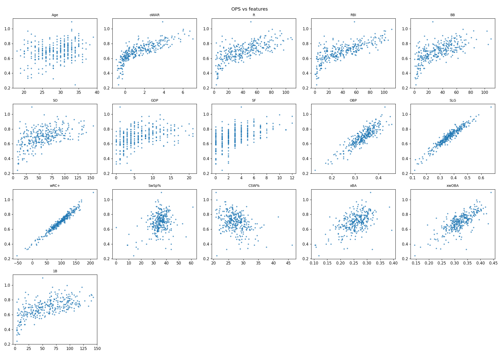
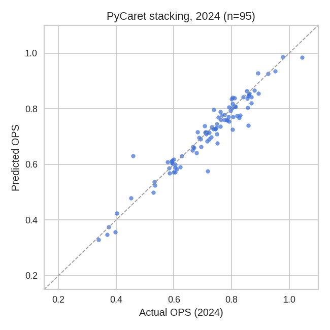

# ⚾ KBO 타자 OPS 예측 프로젝트

KBO 타자 2021~2024 기록을 직접 크롤링해 데이터셋을 만들고, 같은 시즌 세부 타격 지표로 OPS를 예측(추정)하는 회귀 모델과 Tableau 팀·선수 대시보드를 만든 팀 프로젝트입니다.

| 항목 | 내용 |
|---|---|
| 기간 | 2025.01 ~ 2025.03 (겨울방학 스터디) |
| 팀 | 잠실은 내꺼야 — 권석민, 김도현, 장유진, 정혜민 (4명) |
| 주제 | 데이콘 「KBO 타자 OPS 예측 경진대회」(2019) 주제를 빌려, 직접 수집한 2021~2024 데이터로 진행 |
| 사용 기술 | Python, Selenium, BeautifulSoup, pandas, PyCaret, scikit-learn, Tableau |
| 역할 | 전 과정 공동 수행 — 팀원 모두가 크롤링·전처리·EDA·모델링·대시보드를 각자 진행한 뒤 결과를 비교해 가장 좋은 버전을 채택 |

## 1. 프로젝트 소개

- 데이콘 제공 데이터가 아닌 **웹 크롤링으로 직접 구축한 데이터** 사용
- 2021~2023 시즌으로 학습, **2024 시즌 OPS를 정답으로 떼어 두고 평가**
- Tableau로 팀·선수 대시보드 제작

## 2. 데이터 수집 (크롤링)

| 출처 | 방법 | 주요 변수 |
|---|---|---|
| Statiz | requests + BeautifulSoup | 타격 기록, WAR·oWAR·dWAR, AVG·OBP·SLG·OPS, wRC+ |
| KBO Insight | Selenium + BeautifulSoup (동적 페이지) | wOBA, EV, HardHit%, Barrel%, Whiff%, xBA, xwOBA 등 |

개발자 도구로 표 구조(`tr`/`td`)를 확인해 연도별로 수집했습니다. 출처 사이트를 현재 이용할 수 없어 크롤링 코드는 재실행하지 않고 [`archive/crawling`](archive/README.md)에 보관했으며, 분석은 크롤링으로 만든 최종 데이터 [`data/kbo_batting_2021_2024.csv`](data/README.md)(424행 × 50열)에서 시작합니다.

**데이터 검증**: 최종 데이터의 Statiz 출처 열 29개를 Statiz 수집 원본과 대조한 결과, 동명이인을 제외한 402행에서 불일치 0건입니다.

## 3. 전처리

| 단계 | 내용 | 위치 |
|---|---|---|
| ① 크롤링 데이터 다듬기 | 4시즌 모두 기록이 있는 선수만, 은퇴·해외 이적 선수 제외, 동명이인은 이름 뒤 팀 표기 | 최종 CSV에 반영됨 |
| ② 30타석 미만 삭제 | 표본이 적어 기록이 불안정한 시즌 제외 → 학습 307행 / 평가 95행 | `src/data.py` |
| ③ H(안타) 수정 | H − 2B − 3B − HR = 순수 1루타(1B), 장타 변수와 중복 제거 | `src/data.py` |
| ④ 중복 변수 제거 | 다른 변수로 계산되거나 의미가 겹치는 변수 제거 | 모델링 02~04에만 적용 (`src/data.py`) |
| ⑤ 상관관계·VIF 기반 제거 | 야구 지표는 서로 계산 관계로 묶여 있어 다중공선성이 큼 (VIF 10 초과 34/45개) → VIF가 높은 변수를 제거하되 OPS 핵심 지표(OBP, SLG, wRC+)는 유지 | 모델링 02~04에만 적용 (`src/data.py`) |

결측값은 1건(Chase%)뿐이며 ② 기준에서 제외됩니다. 이상치는 별도로 처리하지 않았습니다.

모델별 입력 변수
- **모델링 01 (PyCaret)**: ①~③ 후 식별 정보와 OPS를 직접 계산하는 지표(OBP, SLG, TB, R/ePA 등)만 뺀 36개
- **모델링 02~04 (PCA)**: ④·⑤ 이후 남은 16개 (나이, oWAR, R, RBI, BB, SO, GDP, SF, OBP, SLG, wRC+, SwSp%, CSW%, xBA, xwOBA, 1B)

## 4. EDA (`src/01_eda.py`)

| OPS와의 상관계수 | 주요 변수 산점도 |
|---|---|
|  |  |

- R/ePA, wOBA, wRC+, SLG, OBP가 OPS와 강한 양의 상관 (|r| 0.88~0.99)
- OBP, SLG, xwOBA는 정규분포에 가깝고, SF·GDP는 특정 값에 몰리는 등 정규성에서 벗어남 (`histograms.png`, `qq_plots.png`)
- ⑤ 이후 남은 16개 변수에서도 VIF가 높음 (wRC+ 61.4, OBP 26.5, SLG 18.2) → 다중공선성을 줄이기 위해 PCA 시도 (모델링 02~04)

## 5. 모델링

### 모델링 01 — PyCaret + 스태킹 ✅ 최종 (`src/02_pycaret_stacking.py`)

1. `compare_models`: 회귀 모델 전체를 10-fold 교차검증 → RMSE 상위 5개 (선형회귀, Bayesian Ridge, Huber, Ridge, OMP)
2. `tune_model`: 5개 하이퍼파라미터 튜닝
3. `stack_models`: 스태킹 (메타모델 선형회귀)

### 모델링 02~04 — PCA + 스태킹 (`src/03_pca_stacking.py`)

누적 설명분산 90% 기준으로 주성분 3개(93.0%)를 남긴 뒤, 기반 모델 5개(선형회귀, LARS, Bayesian Ridge, Huber, Ridge)를 스태킹하고 메타모델을 바꿔 비교했습니다.

### 결과 (2024 평가)

| 모델 | RMSE | R² |
|---|---|---|
| **01 PyCaret + 스태킹** | **0.0371** | **0.9261** |
| 02 PCA + 스태킹 (메타모델 선형회귀) | 0.0514 | 0.8587 |
| 03 PCA + 스태킹 (메타모델 Huber) | 0.0510 | 0.8608 |
| 04 PCA + 스태킹 (메타모델 Ridge) | 0.0524 | 0.8531 |



발표 당시에는 PCA로 차원을 줄이면서 정보가 손실돼 성능이 낮아졌다고 보고 모델링 01을 최종 모델로 선택했습니다(한계 2 참고).

## 6. Tableau 대시보드

| 팀 대시보드 | 선수 대시보드 |
|---|---|
|  |  |
|  | |

- 팀: 월별 순위 변동, WAR 상위 30명 소속팀, 연도별 연봉·관중 수, 장타/단타 비율, 상대 전적, 팀별 R/ePA, 주전 선수 WAR
- 선수: 지표 백분위(덤벨 차트), 구종별 타율 추이, 타구 방향 분포, 레이더 차트, 도루 성공률
- 원본 파일: [`tableau/kbo_dashboard.twbx`](tableau/kbo_dashboard.twbx) (Tableau Desktop / Reader로 열기)

## 한계

1. **같은 시즌 기록으로 그 시즌 OPS를 맞히는 구조입니다.** OPS = OBP + SLG이고 두 값은 안타·2루타·3루타·홈런·볼넷·타수 등으로 계산됩니다(데이터에서 공식 계산값과 0.001 이내 일치). 모델링 01은 OBP·SLG를 뺐지만 이 구성 요소들이 입력에 남아 있어, 높은 R²는 다음 시즌 예측력이 아니라 세부 지표로 OPS를 재구성한 결과에 가깝습니다.
2. **PCA 실험(02~04)은 입력에 OBP·SLG가 포함돼 있고, 표준화 없이 PCA를 적용했습니다.** 주성분 3개가 값의 범위가 큰 변수(wRC+, 1루타, 삼진, 타점)로 대부분 채워지고 OBP·SLG처럼 범위가 작은 변수는 거의 반영되지 않아, "PCA라서 성능이 낮다"고 결론 내리기 어렵습니다.
3. **2024 평가 오차가 교차검증보다 3배 이상 큽니다** (RMSE 0.0371 vs 0.0103). 오차가 큰 선수 다수에서 KBO Insight의 wOBA가 Statiz의 OBP·SLG와 맞지 않았으며, 원인은 확인하지 못했습니다.
4. **표본이 작고 치우쳐 있습니다.** 4시즌 연속 출전한 106명만 남아 주전급 위주입니다. 또 측정 타구가 적은 선수는 극단값이 남아 있습니다(예: 2024 김호령 67타석, HardHit%·Barrel% 100%, xwOBAcon 1.659). 이 선수는 최종 모델에서 오차가 가장 컸습니다.
5. **보관된 크롤링 코드로 최종 데이터를 그대로 다시 만들 수는 없습니다.** 크롤링·전처리를 팀원별로 진행한 뒤 결과를 합쳐 최종 데이터를 만들었기 때문에, 보관된 크롤링 코드와 최종 데이터의 변수 구성이 일부 다릅니다. 출처 사이트도 바뀌어 다시 수집하거나 맞춰 수정할 수 없습니다. 대신 최종 데이터의 Statiz 부분은 수집 원본과 일치함을 확인했습니다(402행 불일치 0건).
6. **발표 자료와 코드의 표기 차이**: 발표 자료의 "Robust 스케일링"은 실제 코드상 z-score 표준화(`normalize=True`)입니다. 전처리 ④의 중복 변수 표(Own%, IsoP, K, BB/K 등)는 이전 버전 데이터 기준이라 최종 데이터에 없는 변수가 포함돼 있습니다.

## 레포 구조

```
kbo-ops-prediction/
├── data/
│   ├── kbo_batting_2021_2024.csv     # 크롤링으로 만든 최종 데이터
│   └── README.md                     # 열 설명
├── src/
│   ├── data.py                       # 공통: 로드·전처리·분할, 모델별 변수 목록
│   ├── 01_eda.py                     # 4. EDA
│   ├── 02_pycaret_stacking.py        # 5. 모델링 01 (최종)
│   └── 03_pca_stacking.py            # 5. 모델링 02~04
├── results/                          # 단계별 결과 (그래프, 지표, 예측값)
├── tests/test_data.py                # 데이터·전처리 확인
├── tableau/kbo_dashboard.twbx        # Tableau 대시보드 원본
├── assets/                           # 대시보드 이미지
└── archive/                          # 크롤링·병합·원본 노트북 (참고용)
```

## 실행

```bash
# Python 3.11 (PyCaret 3.3.2 지원 범위)
pip install -r requirements.txt
python -m pytest -q
python src/01_eda.py
python src/02_pycaret_stacking.py   # 약 2분
python src/03_pca_stacking.py
```

Python 3.11.15 · PyCaret 3.3.2 환경에서 전체 실행과 발표 수치 재현을 확인했습니다.
